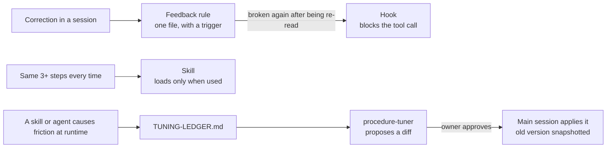

# Claude Code workspace architecture

[](https://github.com/terezakohutova/claude-code-architecture-showcase/actions/workflows/ci.yml)

This is the structure I run my day-to-day marketing work on in Claude Code
(paid ads, a partner CRM, e-mail flows, a website), with the company taken
out. Every business detail is moved to a made-up vintage shop called
"Marlowe and Finch". The structure, the hooks and the design decisions are
the real ones.

| Before | After |
|---|---|
| A correction is forgotten by the next session | One rule per file in `Feedback/`, indexed by when to open it |
| A rule is written down and still gets broken | It becomes a hook that blocks the tool call |
| The same weekly procedure is explained again every time | It becomes a skill that loads only when used |
| A research task floods the main thread with tool calls | A scoped agent does it and returns the finished result |
| An agent "improves" its own instructions | It proposes a diff, a person approves, the old version is kept |

Five hooks, 133 tests, CI on Linux, macOS and Windows, and one recorded
headless Claude Code session in which the hooks blocked and allowed what
they should.

## Try it in 30 seconds

Node 18.17 or newer, nothing to install.

```
git clone https://github.com/terezakohutova/claude-code-architecture-showcase
cd claude-code-architecture-showcase
node .claude/hooks/style-guard.js < examples/payloads/write-superlative.json
```

The payload is a `Write` of "This is a truly best-in-class vase, a real
must-have for any collector." into a listing. The hook answers with the
decision Claude Code acts on:

```json
{"hookSpecificOutput":{"hookEventName":"PreToolUse","permissionDecision":"deny","permissionDecisionReason":"Style guard: banned superlative \"best-in-class\" found near: \"This is a truly best-in-class vase, a real must-have for an\" (and 1 more). See Feedback/no-marketing-superlatives.md, rewrite before saving."}}
```

Clean copy gets no output at all, so the normal permission prompt still
applies:

```
node .claude/hooks/style-guard.js < examples/payloads/write-clean.json
```

And the whole contract:

```
npm test
```

```
ℹ tests 133
ℹ pass 133
ℹ fail 0
OK: 22 Markdown files, all links and quoted paths resolve, no em/en dashes, tables intact.
```

## How a rule moves



A correction starts as a one-off note in `Feedback/`. If it is broken again
even though it is written down and re-read, more emphasis will not help, so
it moves into a hook: a hook does not get tired of a rule. A procedure that
needs the same 3+ steps every time becomes a `SKILL.md`. Work that is heavy
on tool calls or needs its own kind of judgment becomes an agent with
narrow tools and one job.

## The layers

```
CLAUDE.md                    index only: short, links out, never grows
  |
  +-- <Topic>/
  |     <topic>-reference.md   stable facts, rarely rewritten
  |     <topic>-status.md      current state, dated, expected to age
  |
  +-- Feedback/                 soft rules, one file per corrected/confirmed behavior
  |     INDEX.md                 trigger -> file, never "file X describes Y"
  |
  +-- .claude/hooks/            hard rules, promoted from Feedback
  +-- .claude/skills/           repeated procedures, out of the always-read index
  +-- .claude/agents/           scoped delegates: minimal tools, one job
  +-- Log/                      newest on top, one file per month
```

## The hooks

Registered in [`.claude/settings.json`](.claude/settings.json), plain Node,
no dependencies.

| Hook | Event / matcher | What it does |
|---|---|---|
| [`scope-guard.js`](.claude/hooks/scope-guard.js) | PreToolUse, `Read\|Edit\|Write\|MultiEdit\|NotebookEdit\|Glob\|Grep` | Denies a file tool call that resolves outside the project: absolute paths, `../`, `~`, symlinks that point out, Glob patterns and Grep `glob` filters (brace alternatives expanded, a `..` after a wildcard denied). Also denies any write to the settings files and `.claude/hooks/`, so the agent can't switch its own guardrails off. |
| [`style-guard.js`](.claude/hooks/style-guard.js) | PreToolUse, `Edit\|Write\|MultiEdit\|NotebookEdit` | Denies a banned superlative ([list](Feedback/banned-phrases.json)) or an em/en dash in customer-facing copy (`Inventory/listings/`, `Copy/`). The hard half of [a Feedback rule](Feedback/no-marketing-superlatives.md). |
| [`bash-guard.js`](.claude/hooks/bash-guard.js) | PreToolUse, `Bash` | Inside the `brand-voice-reviewer` subagent, allows only `node scripts/style-check.js <file>...` on project files. Chaining, substitution, redirection and extra flags are denied. |
| [`version-snapshot.js`](.claude/hooks/version-snapshot.js) | PreToolUse, `Edit\|Write\|MultiEdit\|NotebookEdit` | Copies a rule, agent, skill, `CLAUDE.md`, settings file or hook to `.versions/` before it changes, keeping the newest 20 per file. Never blocks. |
| [`tuning-ledger-check.js`](.claude/hooks/tuning-ledger-check.js) | SessionStart, `startup` | If [the tuning ledger](.claude/TUNING-LEDGER.md) has an open line, tells the new session to raise it and offer `procedure-tuner`. |

A deny is the documented PreToolUse decision on stdout. An allowed call
gets no output, so Claude Code's own permission prompts still apply. The
rules `style-guard` uses live in
[`.claude/hooks/lib/style-rules.js`](.claude/hooks/lib/style-rules.js) and
are shared with [`scripts/style-check.js`](scripts/style-check.js), which
`brand-voice-reviewer` runs, so the reviewer and the gate can't disagree.

### What scope-guard lets out of the folder

Claude Code reads and writes some of its own files outside the project. A
guard that blocks those breaks the tool it is guarding, so the allow-list
is explicit and narrow:

| Where | Allowed |
|---|---|
| `<config>/projects/<this project>/`, `<config>/plans/`, `<config>/todos/` | read and write |
| `<config>/skills/`, `<config>/agents/`, `<config>/commands/`, `<config>/CLAUDE.md` | read only |
| `<OS temp>/claude/<this project>/`, `<OS temp>/claude-*/<this project>/` | read and write |
| other projects' folders in either place, and the rest of `<config>` | denied |

`<config>` is `$CLAUDE_CONFIG_DIR`, otherwise `~/.claude`. `<this project>`
is the folder name Claude Code derives from the project path (every
character other than a letter or digit becomes `-`, so `C:\Users\me\My_Shop`
becomes `C--Users-me-My-Shop`), plus the folder of the current session's
transcript. Each row has a test in [`tests/hooks.test.js`](tests/hooks.test.js).

## See it run

- [`examples/hook-verification.md`](examples/hook-verification.md): each
  hook run from a terminal with the sample payloads in
  [`examples/payloads/`](examples/payloads) (a test keeps the page in step
  with the hooks), then four of them inside a headless Claude Code session
  (Claude Code 2.1.296, 2026-10-13), with the command, prompt and tool calls
  saved in [`examples/transcripts/`](examples/transcripts).
- [`examples/sample-listing.md`](examples/sample-listing.md): the listing a
  fresh agent wrote from only the `product-listing` skill and two inventory
  files. That run is how the skill's wrong Draft -> Live step was found.
- [`examples/skill-generation-session.md`](examples/skill-generation-session.md):
  instead of describing an automation up front, the agent was pointed at a
  folder of saved short-form videos and asked what was worth building. Six
  candidates came out, two more were turned down with a reason, and one
  ([`commitment-tracker`](.claude/skills/commitment-tracker/SKILL.md)) was
  built and run on [`examples/sample-call-notes.md`](examples/sample-call-notes.md).
- [`examples/self-tuning-session.md`](examples/self-tuning-session.md): the
  second escalation path. A dead `Edit` grant was seeded on
  `inventory-researcher` and logged to the ledger, and a fresh agent given
  only `procedure-tuner.md` found it.

## Agents that change agents

An agent that edits the instructions other agents run on is the riskiest
piece here. `procedure-tuner` has only `Read`, `Grep` and `Glob`. It returns
numbered diffs, the main session applies one only after the owner says
yes, and `version-snapshot` copies the file first. A test fails if a write
tool is ever added to its `tools:` line. (The demo run predates this rule
and applied its fix itself; the example says so.)

`version-snapshot.js` is the undo for all of it. Git only has what was
committed; the snapshots in `.versions/<path>/<UTC timestamp>.md`
(git-ignored, with an `index.jsonl` of time, tool, reason, SHA-256 and
session) cover the edits in between. In my real workspace the same hook
protects the files the ads agents depend on.

## What's in this repo

- [`CLAUDE.md`](CLAUDE.md), the index, and [`METHODOLOGY.md`](METHODOLOGY.md),
  the method for building this structure on a new project. Start with
  METHODOLOGY.
- [`Feedback/`](Feedback/INDEX.md): the style rule that got escalated to a
  hook, and the rule that feeds the tuning ledger.
- [`.claude/skills/`](.claude/skills): `product-listing` (Draft -> Ready for
  review; Live only once a person has posted it) and `commitment-tracker`,
  which writes to [`TODO.md`](TODO.md).
- [`.claude/agents/`](.claude/agents): research (`inventory-researcher`),
  review (`brand-voice-reviewer`, which compares a draft with the published
  copy in [`Brand/voice-examples.md`](Brand/voice-examples.md)) and
  self-tuning (`procedure-tuner`).
- [`Log/`](Log/2026-01.md): one month showing the format.
- [`tests/`](tests) and [`scripts/check-docs.js`](scripts/check-docs.js):
  the hook tests, plus a check that every link and quoted path resolves,
  tables render and the docs follow their own no-dash rule.

To reuse the hooks, copy `.claude/hooks/` (with `lib/`), the `hooks` and
`permissions` blocks of `.claude/settings.json` and `tests/`, set
`COPY_DIRS` in `.claude/hooks/lib/style-rules.js` to wherever your
customer-facing copy lives, and run `npm test`.

## Threat model

The hooks are guardrails against careless calls. They are not a security
boundary, and these are the gaps:

- **Bash.** `scope-guard` covers the file tools. The `permissions` block in
  `.claude/settings.json` denies the obvious shell routes out (`curl`,
  `wget`, `ssh`, `git push`, `rm -rf`, `sudo`, reading `.env`, `~/.ssh`,
  `~/.aws`) and edits to the settings and hooks. Every other Bash command
  still needs the user's approval, and a prefix rule matches command text,
  so an approved `cat ../other/file` or an interpreter one-liner gets
  through. For an OS-level boundary, turn on Claude Code's sandbox (macOS,
  Linux, WSL2): [`examples/settings.sandbox.json`](examples/settings.sandbox.json)
  is a starting point. It is not in the active settings because CI and the
  recorded session ran on native Windows, where the sandbox doesn't exist.
- **Fail-open on errors.** If a guard gets a payload that isn't valid JSON
  or fails internally, it logs to stderr and lets the call go on to the
  normal permission flow. A broken guard that blocked every call would also
  block the session that fixes it. `GUARD_FAIL_CLOSED=1` turns these
  errors into denies. Both behaviors have tests.
- **What style-guard can't see.** Copy written by a Bash command, typed by
  browser automation or posted by an integration is checked only if
  someone runs `scripts/style-check.js` on it. The list is phrase-level
  regex, so it skips code spans and honest uses ("Revolutionary War era")
  and misses a superlative it doesn't list.
- **`bash-guard` relies on `agent_type`** in the hook input. A Claude Code
  version that doesn't send it looks like the main thread, and the normal
  permission flow decides. The fallback is the same check in the agent's
  own `hooks:` frontmatter.
- **Trust.** Claude Code ignores a project's `permissions.allow` until the
  folder has been trusted once interactively. The deny rules and the hooks
  apply either way.
- **Coverage of the recorded session.** It predates `bash-guard` and the
  guardrail-file denies, which are covered by the test suite only.

## What's left out

My real workspace has more sub-projects, skills and integrations (mail,
notes, browser automation) and a lot of business detail that has no
business being public. This repo keeps the shape, not a copy.
